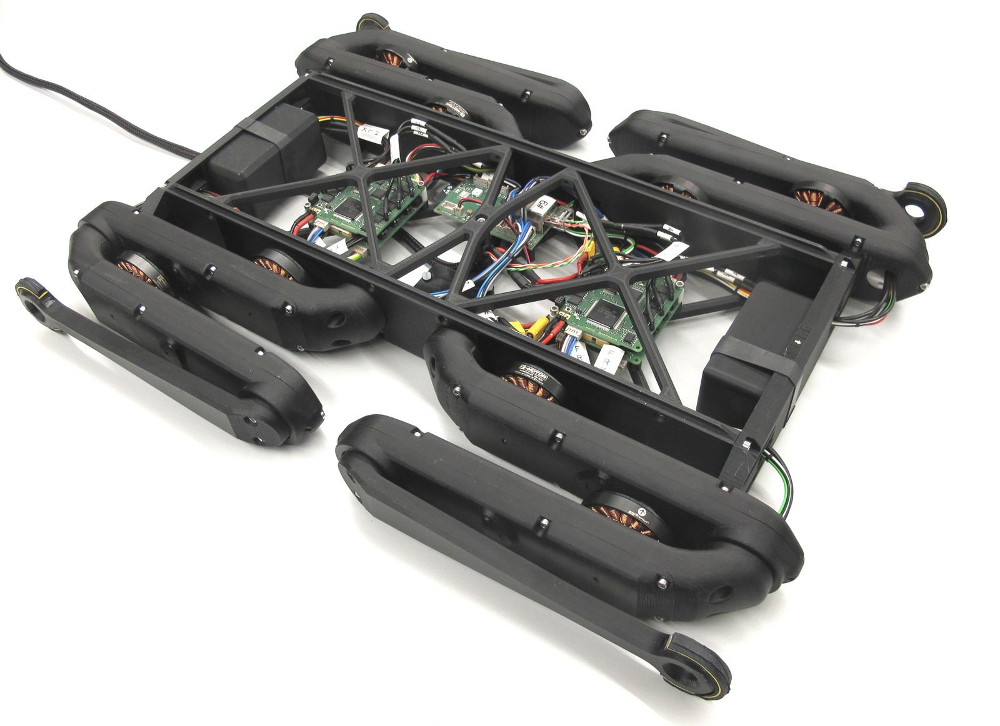

# Solo-8 Open Torque-Controlled Quadruped Robot (Refurbished)



An 8-joint open-source research quadruped with back-drivable brushless timing-belt actuators, optical encoders and open driver electronics. It can jump, trot and recover from pushes, and weighs under 2 kg. This is a refurbished remix of [Solo-8 (Quadruped Robot 8dof v2)](https://github.com/open-dynamic-robot-initiative/open_robot_actuator_hardware) by Felix Grimminger and the Open Dynamic Robot Initiative.

## Install and build guide

### 1. What you build

- 8 actuator modules (each: motor, encoder, two-stage AT3 timing belt, printed pulleys).
- 4 two-joint legs (hip shell, upper-leg shell, lower leg) with two actuators each.
- 1 body frame with the Master Board, 4 Micro Driver boards and an IMU.

### 2. Print list

| Qty | File | Notes |
|---:|---|---|
| 1 | body_structure_bottom.STL | |
| 2 | body_structure_front.STL | front and back plates are identical |
| 2 | body_structure_side.STL | left and right are identical |
| 1 | body_structure_top.STL | or one of the two top variants below |
| 1 | body_structure_top_vicon.STL | optional, motion-capture marker mounts |
| 1 | body_structure_top_roll_bar.STL | optional, marker mounts with roll bars |
| 8 | spacer_micro_driver_stack_12mm.STL | electronics stack spacers |
| 8 | spacer_micro_driver_stack.STL | optional alternative spacer |
| 2 | battery_placeholder.STL | optional, weight placeholders for battery tests |
| 1 | stand_adapter.STL | optional, for a test stand |
| 4 | hip_module_shell_base.STL | |
| 4 | hip_module_shell_cover.STL | |
| 4 | upper_leg_module_shell_base.STL | |
| 4 | upper_leg_module_shell_cover.STL | |
| 4 | lower_leg_v3.STL | print solid; or lower_leg_v2.STL with a sparse/double-dense setting |
| 8 | transmission_pulley_at3_t30_center.STL | SLA / precision |
| 8 | transmission_pulley_at3_t30_output.STL | SLA / precision |
| 16 | transmission_belt_tensioner_roller_10.0mm.STL | SLA; the 9.0–11.5 mm versions let you tune belt tension |
| 8 | encoder_codewheel_kit_mount.STL | SLA; for the encoder kit |
| 8 | encoder_codewheel_pwb_mount.STL | SLA; only if you buy encoder and codewheel separately |
| 1 each | tool_*.STL | assembly jigs: shaft extraction, pulley bonding, code wheel bonding, pulley protection, output pulley modification |

Structural parts: PC-ABS or PETG on FDM, or SLS nylon. Precision parts: tough resin on SLA. Print in the positive Z direction of each STL.

### 3. Bought and machined parts

The shop list covers the off-the-shelf parts: 61705-2RS and 683 bearings, fasteners, Helicoil inserts, wire, connectors, the crimp tool, the bench power supply, the Ethernet cable, adhesive and print materials.

These parts are bought directly from the named maker and are not in the shop list:

- Motors: T-Motor Antigravity 4004 300KV, 8 pcs (sold in pairs). Buy from T-Motor.
- Encoders: Broadcom AEDM-5810-Z12 kit (encoder + codewheel), 8 pcs. Buy from a Broadcom distributor such as Mouser or Digi-Key.
- Timing belts: ContiTech Conti Synchroflex AT3 GEN III, polyurethane with steel cord: 150 mm / 50 teeth / 4 mm wide (8 pcs) and 201 mm / 67 teeth / 6 mm wide (8 pcs). Buy from ContiTech or a ContiTech belt dealer.
- MR84 open bearings, 8 x 4 x 2 mm, 24 pcs (stainless preferred). Buy from EZO, through SBN, EZO USA or Emiliana Cuscinetti.
- IMU: MicroStrain 3DM-CX5-25, 1 pc. Buy from MicroStrain.
- Machined parts, 8 sets (4 mm stainless motor shaft, aluminum 10-tooth motor pulley, center pulley). Order from a CNC machining service using the published ODRI drawings, or buy the ODRI encoder kit that includes them.
- Electronics: ODRI Master Board v2 (1) and Micro Driver v2 (4). Order from a PCB assembly service using the ODRI design files.

### 4. Actuator modules (x8)

1. Prepare the motor: remove the stock shaft and fit the 4 mm motor shaft with the extraction and bonding jigs.
2. Bond the motor pulley and the codewheel to the shaft using the printed bonding jigs. Let the adhesive cure fully.
3. Prepare the center pulley and the output pulley with their jigs.
4. Fit bearings into the hip or upper-leg shell base, install the motor with M3 x 5 flat head screws, then the encoder with M3 x 16 polyamide screws.
5. Install both belts, set the tension with the rollers (M3 x 10 flat head screws and washers) and close the shell cover.
6. Spin the output by hand. It should turn smoothly with no tight spots.

### 5. Legs and body

1. Join a hip module and an upper-leg module into one 2-joint leg. Fit the lower leg to the knee output.
2. Insert Helicoil M3 threads into the body parts (25 x M3 x 4.5 and 8 x M3 x 6).
3. Assemble the body with M3 x 8 socket screws and fix each leg to the front or back plate with M3 x 12 screws.

### 6. Electronics and wiring

- Micro Driver v2: 4 boards, each drives 2 motors. Mount them as two 2-board stacks (front and back) on the printed spacers with M2.5 x 20 screws.
- Master Board v2: fit with M2 x 6 screws. It talks to the Micro Drivers over SPI and to the PC over Ethernet.
- IMU: LORD MicroStrain 3DM-CX5-25 on M2.5 x 16 polyamide screws. Measure its offset from the body origin if you change the mount.
- Motor phases: 2 mm gold connectors on 0.5 mm² wire. Encoders: Hirose DF13 5-pin with 0.14 mm² wire (crimp tool needed).
- Suggested wire lengths: hip phases 6 cm, hip encoder 10 cm, knee phases 12 cm, knee encoder 19 cm, SPI 14–20 cm.

### 7. Software and first power-up

1. Flash the Micro Driver and Master Board firmware from the Open Dynamic Robot Initiative software.
2. On a Linux PC, install the ODRI control software and connect the Master Board over Ethernet.
3. Power from a current-limited 24 V supply. Start with the robot hanging on a stand and the legs free.
4. Run the encoder index search and calibration, then a low-gain position test on one joint at a time.

### Safety and limits

- Use a current-limited supply and keep an emergency stop (power cut) within reach.
- Never touch the legs or belts while the drivers are enabled.
- Printed pulleys wear. Inspect belts and pulleys after every few hours of running.

### Troubleshooting

- Joint jumps or vibrates: encoder codewheel not centered, or wrong calibration offset.
- Belt skips under load: increase tension with a larger roller size.
- No communication: check the SPI cable order and the Master Board Ethernet link before suspecting a driver.

### Software and source links

- Master Board hardware design, firmware and SDK: https://github.com/open-dynamic-robot-initiative/master-board
- Micro Driver design files: https://github.com/open-dynamic-robot-initiative/open_robot_actuator_hardware/tree/66af1522b4fba0ec4a1d7790e66f5e4652208d30/electronics
- Micro Driver firmware: https://github.com/open-dynamic-robot-initiative/udriver_firmware
- Robot control interface for the Linux PC: https://github.com/open-dynamic-robot-initiative/odri_control_interface
- Original robot, leg and actuator documentation, drawings and STEP files: `source/upstream/mechanics/` in this repository.

## Documentation download

This repository is the documentation and source download for the build.

- **Download ZIP:** use GitHub's **Code → Download ZIP** button, or clone:

  ```bash
  git clone https://github.com/ToolKnox/hawkridge-odri-solo8-open-quadruped-robot.git
  ```

- **Build guide:** this README, also as [`docs/build-guide.md`](docs/build-guide.md).
- **Robot print files (STL):** [`source/upstream/mechanics/quadruped_robot_8dof_v2/stl_files/`](source/upstream/mechanics/quadruped_robot_8dof_v2/stl_files/)
- **Leg print files (STL):** [`source/upstream/mechanics/leg_2dof_v2/`](source/upstream/mechanics/leg_2dof_v2/)
- **Actuator module files, drawings and assembly notes:** [`source/upstream/mechanics/actuator_module_v1/`](source/upstream/mechanics/actuator_module_v1/)
- **Shared parts and STEP files:** [`source/upstream/mechanics/general/`](source/upstream/mechanics/general/)
- **Master Board design, firmware and SDK:** https://github.com/open-dynamic-robot-initiative/master-board
- **Robot control interface:** https://github.com/open-dynamic-robot-initiative/odri_control_interface
- **Original upstream README:** [`source/upstream/README.md`](source/upstream/README.md)

## Repository contents

- `docs/`: the build guide.
- `download-documentation/`: how to download this package.
- `images/`: cover photo.
- `source/upstream/`: mirror of the upstream project at commit `66af1522b4fba0ec4a1d7790e66f5e4652208d30`, with the robot, leg and actuator documentation, STL files, drawings, STEP files and photos.

Not included in this repository: the other robots, test stands and the electronics folder of the upstream hardware repository. They are not needed for the mechanical build; the electronics design files and firmware are linked in the build guide.

## Credits and license

Remix of [Solo-8 (Quadruped Robot 8dof v2)](https://github.com/open-dynamic-robot-initiative/open_robot_actuator_hardware) by Felix Grimminger and the Open Dynamic Robot Initiative, BSD 3-Clause License. Mirrored from commit [`66af152`](https://github.com/open-dynamic-robot-initiative/open_robot_actuator_hardware/tree/66af1522b4fba0ec4a1d7790e66f5e4652208d30). The upstream license is kept at [`LICENSE`](LICENSE) and [`source/upstream/LICENSE`](source/upstream/LICENSE).

Changes by Hawkridge, updated for modern use: one robot-level purchase list merging the robot, leg and actuator lists, one print list with counts, and a single build guide in build order. Files under `source/upstream/` are unmodified.
